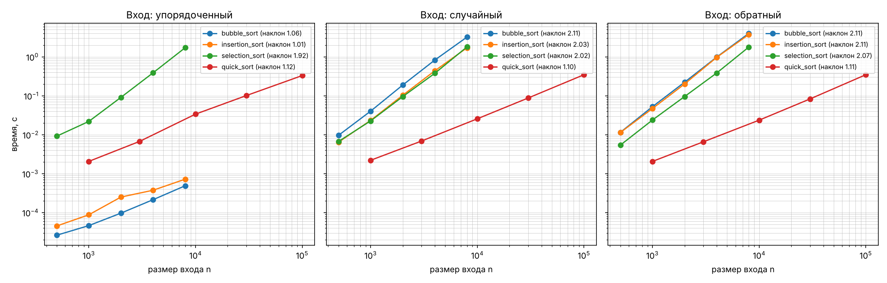

# Отчёт по ЛР 3. Простые сортировки и QuickSort с рандомизацией

**Вариант 17** (seed генератора данных = 30 + 17 = **47**)  
Код: [`../lab03_simple_sorts_quicksort.py`](../lab03_simple_sorts_quicksort.py) · Протокол запуска: [`lab03_run.log`](lab03_run.log)

---

## Введение

Цель данной лабораторной работы: освоить простые сортировки и QuickSort, экспериментально подтвердить их асимптотику на разных классах входов и понять роль стабильности и рандомизации опорного элемента.

Задачи:

- Реализовать сортировки пузырьком, вставками и выбором со счётчиками сравнений и обменов (перемещений); счётчики возвращаются вместе с результатом.
- Реализовать QuickSort с рандомизированным выбором опорного элемента (rng.randrange) и корректной обработкой малых подмассивов.
- Сгенерировать по варианту 17 (seed = 30 + 17 = 47) три класса входов — упорядоченный, случайный, обратный — по 5 размеров с геометрическим шагом и выполнить замеры по методике бенчмаркинга (прогрев, 5 повторов, медиана).
- Продемонстрировать стабильность и нестабильность алгоритмов на массиве пар (ключ, метка).
- Построить log-log графики времени от размера входа для всех алгоритмов и классов входов, сопоставить наклоны с O(n²) и O(n log n), объяснить различия между классами входов (в том числе лучший случай вставок и поведение пузырька на упорядоченных данных).
- Верифицировать реализации: инварианты сортировки (результат упорядочен и является перестановкой входа), сверка с sorted() на сотнях случайных входов, граничные случаи.

Работа выполнена на стартовой заготовке lab03-simple-sorts-quicksort-starter.py: каркас (генерация входов, самопроверка, бенчмарк) оставлен без изменений, заполнены только места TODO.

---

## Выполнение

### 1. Условия эксперимента

| Параметр | Значение |
| --- | --- |
| Процессор | Intel Xeon @ 2,10 ГГц (виртуальная машина, 4 ядра) |
| Python | CPython 3.13 (64 бит), Linux |
| Таймер | time.perf_counter() |
| Прогрев / повторы | 1 прогревочный запуск, 5 повторов, медиана |
| Данные | вариант 17, seed 47; входы строит make_inputs(n, seed) |
| Размеры | простые сортировки: 500, 1000, 2000, 4000, 8000; QuickSort: 1000, 3000, 10 000, 30 000, 100 000 |

Запуск: python lab03_simple_sorts_quicksort.py --variant 17 --out report. Протокол — report/lab03_run.log. Размеры для простых сортировок меньше, чем для QuickSort, поскольку время растёт квадратично: n = 8000 в обратном порядке уже занимает около 4 с.

### 2. Реализация алгоритмов и их анализ

```python
def bubble_sort(a: list) -> tuple[list, int, int]:
    """Сортировка пузырьком. Ожидаемая сложность: Θ(n²) в худшем и среднем случае, Θ(n) в лучшем
    (упорядоченный вход: один проход без обменов) — обоснование в отчёте, п. 1.1.

    Подсказка: досрочный выход, если за проход не было ни одного обмена, —
    именно он даёт лучший случай на упорядоченном входе.
    """
    a = list(a)
    comparisons = swaps = 0
    for end in range(len(a) - 1, 0, -1):  # a[end+1:] уже на своих местах
        swapped = False
        for j in range(end):
            comparisons += 1
            if a[j] > a[j + 1]:  # строгое сравнение: равные не меняются местами
                a[j], a[j + 1] = a[j + 1], a[j]
                swaps += 1
                swapped = True
        if not swapped:
            break
    return a, comparisons, swaps


def insertion_sort(a: list) -> tuple[list, int, int]:
    """Сортировка вставками. Ожидаемая сложность: Θ(n) в лучшем случае (упорядоченный вход),
    Θ(n²) в среднем и худшем (обратный порядок).

    Перемещение — сдвиг одного элемента на позицию вправо; запись вставляемого
    элемента на своё место перемещением не считается (обоснование в отчёте, п. 1.2).
    """
    a = list(a)
    comparisons = moves = 0
    for i in range(1, len(a)):
        key = a[i]
        j = i - 1
        while j >= 0:
            comparisons += 1
            if a[j] > key:  # строгое сравнение: равные не обгоняются
                a[j + 1] = a[j]
                moves += 1
                j -= 1
            else:
                break
        a[j + 1] = key
    return a, comparisons, moves


def selection_sort(a: list) -> tuple[list, int, int]:
    """Сортировка выбором. Ожидаемая сложность: Θ(n²) на любом входе — число сравнений
    n(n−1)/2 не зависит от данных, обменов не больше n − 1."""
    a = list(a)
    comparisons = swaps = 0
    n = len(a)
    for i in range(n - 1):
        m = i
        for j in range(i + 1, n):
            comparisons += 1
            if a[j] < a[m]:
                m = j
        if m != i:  # обмен только если минимум не на своём месте
            a[i], a[m] = a[m], a[i]
            swaps += 1
    return a, comparisons, swaps


# ---------------------------------------------------------------------------
# 2. QuickSort с рандомизированным опорным элементом
# ---------------------------------------------------------------------------


def quick_sort(a: list, rng: random.Random | None = None) -> list:
    """QuickSort с выбором опорного через rng.randrange. Возвращает новый список.

    Ожидаемая сложность: в среднем Θ(n log n), в худшем случае Θ(n²)
    (обосновать в отчёте, объяснить роль рандомизации). rng передаётся снаружи, чтобы
    запуск был воспроизводим по seed варианта.
    """
    if rng is None:
        rng = random.Random()
    # Цикл со стеком границ вместо рекурсии: нет ограничения глубины Python.
    # Трёхстороннее разбиение (<, ==, >) по опорному: массив из равных
    # элементов обрабатывается за один проход, а не за Θ(n²).
    a = list(a)
    stack = [(0, len(a))]  # полуинтервалы [lo, hi)
    while stack:
        lo, hi = stack.pop()
        if hi - lo < 2:  # подмассивы длины 0 и 1 уже отсортированы
            continue
        pivot = a[rng.randrange(lo, hi)]
        lt, i, gt = lo, lo, hi  # a[lo:lt] < pivot, a[lt:i] == pivot, a[gt:hi] > pivot
        while i < gt:
            if a[i] < pivot:
                a[lt], a[i] = a[i], a[lt]
                lt += 1
                i += 1
            elif a[i] > pivot:
                gt -= 1
                a[i], a[gt] = a[gt], a[i]
            else:
                i += 1
        # Сначала кладём большую часть: глубина стека не превышает log2(n).
        parts = [(lo, lt), (gt, hi)]
        parts.sort(key=lambda p: p[1] - p[0], reverse=True)
        stack.extend(parts)
    return a


```

#### 2.1 Сортировка пузырьком

Каждый проход сравнивает соседние элементы и выталкивает максимум в конец; после прохода с номером k последние k элементов на своих местах. Сравнения строгие (a[j] > a[j+1]), поэтому равные элементы не меняются местами — сортировка стабильна. Досрочный выход при проходе без обменов даёт лучший случай. Худший случай (обратный порядок): n(n−1)/2 сравнений и столько же обменов, T(n) = Θ(n²). Лучший случай (упорядоченный вход): один проход, n − 1 сравнение, 0 обменов, T(n) = Θ(n). В среднем число обменов равно числу инверсий ≈ n(n−1)/4, сравнений порядка n²/2: Θ(n²). Память O(1) сверх копии.

#### 2.2 Сортировка вставками

Элемент a[i] вставляется в уже упорядоченный префикс: большие элементы сдвигаются вправо на одну позицию. Перемещением считается сдвиг; запись вставляемого элемента на своё место не считается. Число сдвигов равно числу инверсий входа. Лучший случай (упорядоченный вход): n − 1 сравнение, 0 сдвигов, Θ(n). Худший (обратный): n(n−1)/2 сравнений и сдвигов, Θ(n²). Средний случай: n²/4 сдвигов, Θ(n²). Стабильна: равные элементы не обгоняются (строгое >).

#### 2.3 Сортировка выбором

На шаге i в неотсортированной части ищется минимум (всегда n − 1 − i сравнений) и ставится на место обменом. Число сравнений n(n−1)/2 не зависит от данных: даже на упорядоченном входе алгоритм не знает, что минимум уже на месте, пока не просмотрит весь остаток. Поэтому Θ(n²) на любом входе. Обменов не больше n − 1 (обмен делается только если минимум не на своём месте), и именно это отличает выбор от вставок: он делает мало перестановок, но много сравнений. Нестабилен: дальний обмен перебрасывает элемент через равные ему.

#### 2.4 QuickSort с рандомизацией

Опорный элемент выбирается случайно: a[rng.randrange(lo, hi)]. Массив разбивается на три части (меньше, равно, больше опорного), затем обрабатываются части «меньше» и «больше»; подмассивы длины 0 и 1 пропускаются. Трёхстороннее разбиение выбрано, чтобы массив из равных элементов обрабатывался за один проход (при двустороннем разбиении он дал бы Θ(n²)). Рекурсия заменена циклом со стеком границ, большая часть кладётся в стек первой, поэтому глубина стека не превышает log₂ n.

**Средний случай Θ(n log n).** Со случайным опорным ожидаемое число сравнений C(n) = n − 1 + (2/n)·ΣC(k) и решается как ≈ 2n ln n ≈ 1,39 n log₂ n. Рандомизация делает это ожидание верным для любого входа, а не только для случайного: разбиения в среднем достаточно сбалансированы (с вероятностью ≥ 1/2 опорный лежит в средней половине, и размер задачи убывает в геометрическую прогрессию). **Худший случай Θ(n²)** возникает, когда опорный каждый раз оказывается минимумом или максимумом: T(n) = T(n−1) + Θ(n). При детерминированном выборе (первый или последний элемент) на это работают именно упорядоченный и обратный входы; при случайном выборе вероятность такой последовательности экспоненциально мала, и на упорядоченном, случайном и обратном входах время одинаково (см. п. 5).

### 3. Верификация корректности

Все проверки собраны в self_check() и выполняются до замеров; итог прогона: self_check: OK. Собственные проверки оформлены явными исключениями (expect, SelfCheckError), а не assert, поскольку assert отключается при запуске python -O.

#### 3.1 Граничные случаи и сверка с эталоном

Для каждой из четырёх сортировок каркас проверяет пять граничных входов и сверку с sorted() на 300 случайных массивах (длина 0–80, значения −100…100); на каждом входе проверяются два инварианта: результат упорядочен и является перестановкой входа.

| Вход | Ожидаемый результат | Статус |
| --- | --- | --- |
| [] (пустой массив) | [] | ✓ |
| [7] (один элемент) | [7] | ✓ |
| [5, 5, 5, 5] (все равны) | [5, 5, 5, 5] | ✓ |
| [1, 2, 3, 4, 5] (упорядоченный) | [1, 2, 3, 4, 5] | ✓ |
| [5, 4, 3, 2, 1] (обратный) | [1, 2, 3, 4, 5] | ✓ |
| 300 случайных массивов | равно sorted(a) | ✓ |

#### 3.2 Собственные проверки

| Проверка | Что проверяется |
| --- | --- |
| счётчики пузырька и вставок | n = 30: упорядоченный вход — (n−1, 0), обратный — (n(n−1)/2, n(n−1)/2); у выбора на обратном — (n(n−1)/2, n/2) |
| инвариант «обмен = инверсия» | на 100 случайных массивах число обменов пузырька и сдвигов вставок равно числу инверсий (посчитано перебором); у выбора сравнений ровно n(n−1)/2, обменов ≤ n − 1 |
| вход не изменяется | все четыре сортировки оставляют исходный список без изменений |
| стабильность | на парах (2,a),(1,b),(2,c),(1,d): пузырёк и вставки дают метки b d a c, выбор — b d c a |
| свойства QuickSort | воспроизводимость при одинаковом seed; массивы длины 50 000 из равных элементов, упорядоченный и обратный сортируются корректно и без рекурсии |

### 4. Стабильность

Сортировка стабильна, если элементы с равными ключами сохраняют исходный порядок. Для демонстрации использован класс пар, сравнение которого идёт только по ключу (сравнение кортежей скрыло бы нестабильность, так как кортежи сравниваются ещё и по метке).

| Сортировка | Результат на (2,a) (1,b) (2,c) (1,d) | Нарушений на 1000 случайных массивах | Вывод |
| --- | --- | --- | --- |
| bubble_sort | (1,b) (1,d) (2,a) (2,c) | 0 | стабильна |
| insertion_sort | (1,b) (1,d) (2,a) (2,c) | 0 | стабильна |
| selection_sort | (1,b) (1,d) (2,c) (2,a) | 950 | нестабильна |
| quick_sort | (1,d) (1,b) (2,c) (2,a) | 996 | нестабильна |

Пузырёк и вставки меняют местами только строго неупорядоченные соседние элементы, поэтому равные никогда не обгоняют друг друга. Выбор нестабилен из-за обмена на расстоянии: в примере первый шаг обменивает (2,a) с (1,b), после чего (2,a) оказывается позади (2,c). QuickSort нестабилен, потому что разбиение переставляет элементы через большие расстояния. Стабильность важна, когда сортируют по нескольким ключам подряд (например, сначала по имени, затем по группе: порядок по имени внутри группы должен сохраниться).

### 5. Результаты экспериментов

#### 5.1 Счётчики операций

Сравнения / обмены (для вставок — сдвиги). Таблицы получены на входах варианта 17.

**Пузырёк:**

| n | упорядоченный | случайный | обратный |
| --- | --- | --- | --- |
| 500 | 499 / 0 | 124 695 / 65 187 | 124 750 / 124 750 |
| 1 000 | 999 / 0 | 499 479 / 244 419 | 499 500 / 499 500 |
| 2 000 | 1 999 / 0 | 1 998 139 / 983 565 | 1 999 000 / 1 998 999 |
| 4 000 | 3 999 / 0 | 7 990 979 / 3 957 092 | 7 998 000 / 7 997 994 |
| 8 000 | 7 999 / 0 | 31 987 354 / 15 902 978 | 31 996 000 / 31 995 984 |

**Вставки:**

| n | упорядоченный | случайный | обратный |
| --- | --- | --- | --- |
| 500 | 499 / 0 | 65 682 / 65 187 | 124 750 / 124 750 |
| 1 000 | 999 / 0 | 245 411 / 244 419 | 499 500 / 499 500 |
| 2 000 | 1 999 / 0 | 985 552 / 983 565 | 1 999 000 / 1 998 999 |
| 4 000 | 3 999 / 0 | 3 961 080 / 3 957 092 | 7 998 000 / 7 997 994 |
| 8 000 | 7 999 / 0 | 15 910 969 / 15 902 978 | 31 996 000 / 31 995 984 |

**Выбор:**

| n | упорядоченный | случайный | обратный |
| --- | --- | --- | --- |
| 500 | 124 750 / 0 | 124 750 / 491 | 124 750 / 250 |
| 1 000 | 499 500 / 0 | 499 500 / 991 | 499 500 / 500 |
| 2 000 | 1 999 000 / 0 | 1 999 000 / 1 995 | 1 999 000 / 1 001 |
| 4 000 | 7 998 000 / 0 | 7 998 000 / 3 990 | 7 998 000 / 2 001 |
| 8 000 | 31 996 000 / 0 | 31 996 000 / 7 991 | 31 996 000 / 4 010 |

Сверка с формулами при n = 8000: n(n−1)/2 = 31 996 000 — ровно столько сравнений у выбора на любом входе и у пузырька и вставок на обратном; на упорядоченном входе пузырёк и вставки делают n − 1 = 7 999 сравнений без единого обмена. На случайном входе число обменов пузырька совпадает со сдвигами вставок (инверсии) и близко к n(n−1)/4 = 15 998 000 (измерено 15 902 978); сравнений у пузырька почти n(n−1)/2, а у вставок вдвое меньше. У выбора обменов на случайном входе 7 991 (< n), на обратном — 4 010 (≈ n/2: обратный массив разворачивается парными обменами).

#### 5.2 Время работы

| Алгоритм | n | упорядоченный, с | случайный, с | обратный, с |
| --- | --- | --- | --- | --- |
| bubble_sort | 8000 | 4,89e-04 | 3,22 | 4,01 |
| insertion_sort | 8000 | 7,22e-04 | 1,71 | 3,75 |
| selection_sort | 8000 | 1,72 | 1,80 | 1,79 |
| quick_sort | 10 000 | 0,0338 | 0,0257 | 0,0237 |
| quick_sort | 100 000 | 0,3308 | 0,3484 | 0,3482 |

Полные таблицы времени для всех размеров — в протоколе report/lab03_run.log.

#### 5.3 Наклоны log-log

| Алгоритм | Теория | упорядоченный | случайный | обратный |
| --- | --- | --- | --- | --- |
| bubble_sort | Θ(n) / Θ(n²) / Θ(n²) | 1,06 | 2,11 | 2,11 |
| insertion_sort | Θ(n) / Θ(n²) / Θ(n²) | 1,01 | 2,03 | 2,11 |
| selection_sort | Θ(n²) на всех | 1,92 | 2,02 | 2,07 |
| quick_sort | Θ(n log n) на всех | 1,12 | 1,10 | 1,11 |



**Простые сортировки на случайном и обратном входах.** Наклоны 2,0–2,1 подтверждают Θ(n²). Небольшое превышение двойки у пузырька (2,11) — следствие шума машины и малого числа точек (всего пять на прямой).

**Лучший случай вставок и пузырька.** На упорядоченном входе наклоны 1,01 и 1,06: оба делают n − 1 сравнение и ни одного обмена (см. счётчики), время линейно и на n = 8000 в тысячи раз меньше, чем на случайном (0,0007 и 0,0005 с против 1,7 и 3,2 с). У пузырька это даёт именно досрочный выход: без него он делал бы все n(n−1)/2 сравнений даже на упорядоченном входе.

**Выбор не зависит от входа.** Три кривые лежат на одной высоте (n = 8000: 1,72, 1,80, 1,79 с), наклон ≈ 2 на всех классах, включая упорядоченный (1,92): число сравнений n(n−1)/2 фиксировано. Это его отличие от вставок.

**Вставки против пузырька.** На случайном входе при n = 8000 вставки быстрее пузырька почти вдвое (1,71 против 3,22 с): число перемещений одно и то же (инверсии), но сравнений у вставок вдвое меньше, а сдвиг дешевле обмена. На обратном входе вставки примерно вдвое медленнее, чем на случайном: число сдвигов и сравнений вдвое больше (n(n−1)/2 против ≈ n(n−1)/4).

**QuickSort.** Наклон 1,10–1,12 соответствует n log n: локальный наклон функции n·ln n на log-log графике равен 1 + 1/ln n ≈ 1,10 при n от 10³ до 10⁵. Время практически одинаково на всех трёх классах входов (n = 10⁵: 0,3308, 0,3484, 0,3482 с): благодаря случайному опорному нет «плохих» входов. При n = 10⁴ QuickSort сортирует случайный массив за 0,0257 с, тогда как выбор при n = 8000 тратит 1,80 с — разница в десятки раз при сопоставимом размере.

---

## Вывод

Реализованы и верифицированы три простые сортировки со счётчиками и QuickSort с рандомизацией опорного элемента. Проверка инвариантов, граничные случаи и сверка с sorted() на 300 случайных входах подтвердили корректность кода (self_check: OK).

- Счётчики операций совпадают с формулами: у выбора ровно n(n−1)/2 сравнений на любом входе; у пузырька и вставок — n − 1 сравнение и 0 обменов на упорядоченном входе и n(n−1)/2 сравнений и обменов на обратном; число обменов пузырька и сдвигов вставок равно числу инверсий.
- Время простых сортировок на случайном и обратном входах квадратично (наклоны 2,0–2,1). Лучший случай вставок и пузырька на упорядоченном входе линеен (наклоны 1,01 и 1,06); выбор от входа не зависит (наклон ≈ 2 на всех классах).
- Пузырёк и вставки стабильны, выбор и QuickSort нестабильны (на 1000 случайных массивах нарушений 0, 0, 950 и 996).
- QuickSort со случайным опорным и трёхсторонним разбиением работает за Θ(n log n) (наклон 1,10–1,12) одинаково на упорядоченных, случайных и обратных данных; при n = 10⁵ — около 0,33 с, тогда как квадратичным сортировкам при n = 8000 нужны секунды.
- Рандомизация не устраняет худший случай Θ(n²), но делает его вероятность экспоненциально малой для любого входа, а не только для случайного.
