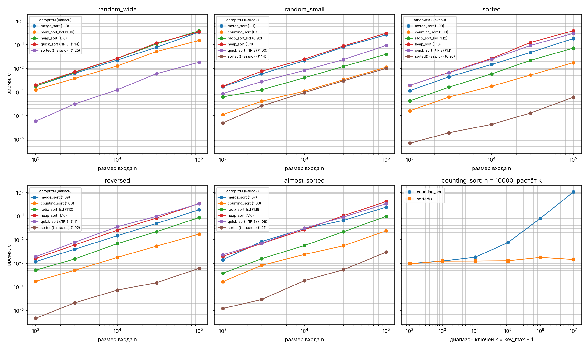

# Отчёт по ЛР 4. MergeSort, Counting, Radix и HeapSort

**Вариант 17** (seed генератора данных = 30 + 17 = **47**)  
Код: [`../lab04_mergesort_linear_heapsort.py`](../lab04_mergesort_linear_heapsort.py) · Протокол запуска: [`lab04_run.log`](lab04_run.log)

---

## Введение

Цель данной лабораторной работы: освоить сортировки с гарантией O(n log n) (MergeSort, HeapSort) и линейно-временные сортировки (CountingSort, RadixSort), сопоставить их свойства — время, память, стабильность, ограничения применимости — и научиться выбирать алгоритм по характеру данных.

Задачи:

- Реализовать MergeSort со стабильным слиянием и подтвердить стабильность тестом на парах «ключ + порядковый номер».
- Реализовать устойчивую CountingSort с префиксными суммами и исследовать, как время и память зависят от диапазона ключей k.
- Реализовать RadixSort LSD по десятичным разрядам поверх устойчивой поразрядной counting-сортировки и показать, почему устойчивость прохода обязательна.
- Реализовать HeapSort через просейку вниз: построение кучи за O(n) и сортировка на месте.
- Выполнить бенчмарк четырёх алгоритмов против QuickSort из ЛР 3 и встроенной sorted() на данных варианта 17 (seed = 47): случайные с широким и узким диапазоном ключей, отсортированные, обратные, почти отсортированные.
- Составить сводную таблицу свойств для всех шести сортировок.
- Верифицировать реализации: инварианты, стабильность, сверка с sorted() на случайных и граничных входах.

Работа выполнена на стартовой заготовке lab04-mergesort-linear-heapsort-starter.py: каркас (генерация данных, самопроверка, бенчмарк) оставлен без изменений, заполнены только места TODO. QuickSort перенесён из ЛР 3.

---

## Выполнение

### 1. Условия эксперимента

| Параметр | Значение |
| --- | --- |
| Процессор | Intel Xeon @ 2,10 ГГц (виртуальная машина, 4 ядра) |
| Python | CPython 3.13 (64 бит), Linux |
| Таймер | time.perf_counter() |
| Прогрев / повторы | 1 прогревочный запуск, 5 повторов, медиана |
| Данные | вариант 17, seed 47; массивы строит make_datasets(rng, n) |
| Размеры | 1000, 3000, 10 000, 30 000, 100 000 |

Запуск: python lab04_mergesort_linear_heapsort.py --variant 17 --out report. Протокол — report/lab04_run.log. Распределения: random_wide — ключи 0…10⁹, random_small — ключи 0…100, sorted и reversed — 0…n, almost_sorted — упорядоченный массив с ~1 % случайных обменов.

### 2. Реализация алгоритмов и их анализ

```python
def merge(left: list, right: list, key) -> list:
    """Стабильное слияние двух отсортированных списков в новый список.

    Стабильность: при равенстве ключей элемент из left идёт раньше.
    Ожидаемая сложность: Θ(len(left) + len(right)) — каждый элемент
    переносится в результат ровно один раз (обоснование в отчёте, п. 2.1).
    """
    out = []
    i = j = 0
    while i < len(left) and j < len(right):
        # Именно <= (а не <) даёт стабильность: при равных ключах первым
        # уходит элемент левой половины, то есть стоявший во входе раньше.
        if key(left[i]) <= key(right[j]):
            out.append(left[i])
            i += 1
        else:
            out.append(right[j])
            j += 1
    out.extend(left[i:])   # одна из половин исчерпана, хвост другой
    out.extend(right[j:])  # уже упорядочен и целиком больше выписанного
    return out


def merge_sort(a: list, key=lambda x: x) -> list:
    """MergeSort: возвращает новый отсортированный список. Ожидаемая сложность:
    Θ(n log n) на любом входе, дополнительная память Θ(n), стабильна."""
    if len(a) <= 1:
        return list(a)  # копия: вход не меняется и результат — новый список
    mid = len(a) // 2   # глубина рекурсии ⌈log2 n⌉ — лимит Python не грозит
    return merge(merge_sort(a[:mid], key), merge_sort(a[mid:], key), key)


def counting_sort(a: list[int], key_max: int) -> list[int]:
    """Устойчивая сортировка подсчётом: ключи — целые из диапазона [0, key_max].

    Схема: массив счётчиков -> префиксные суммы -> расстановка с конца.
    Ожидаемые время и память: Θ(n + k), где k = key_max + 1, — массив
    счётчиков длины k плюс выходной массив длины n; ограничение диапазона
    ключей — отчёт, п. 2.2.
    """
    count = [0] * (key_max + 1)
    for x in a:
        if not 0 <= x <= key_max:  # иначе отрицательный индекс тихо испортил бы результат
            raise ValueError(f"ключ {x} вне диапазона [0, {key_max}]")
        count[x] += 1
    for v in range(1, key_max + 1):  # count[v] — число ключей <= v,
        count[v] += count[v - 1]     # то есть позиция за последним ключом v
    out = [0] * len(a)
    for x in reversed(a):  # с конца: последний из равных встаёт на последнее место
        count[x] -= 1
        out[count[x]] = x
    return out


def radix_sort_lsd(a: list[int]) -> list[int]:
    """RadixSort LSD по десятичным разрядам, неотрицательные целые.

    Поверх устойчивой поразрядной counting-сортировки: от младшего разряда
    к старшему. Ожидаемая сложность: Θ(d·(n + 10)), d — число десятичных
    разрядов максимума; дополнительная память Θ(n + 10).
    """
    if any(x < 0 for x in a):
        raise ValueError("radix_sort_lsd: поддерживаются только неотрицательные ключи")
    out = list(a)
    biggest = max(out, default=0)
    exp = 1
    while biggest // exp > 0:  # d проходов; для пустого входа и [0] — ни одного
        out = counting_by_digit(out, exp)
        exp *= 10
    # Почему проход обязан быть устойчивым — отчёт, п. 2.3; демонстрация —
    # check_radix_needs_stability().
    return out


def counting_by_digit(a: list[int], exp: int) -> list[int]:
    """Один проход radix: устойчивая counting-сортировка по цифре (x // exp) % 10."""
    count = [0] * 10
    for x in a:
        count[(x // exp) % 10] += 1
    for d in range(1, 10):
        count[d] += count[d - 1]
    out = [0] * len(a)
    for x in reversed(a):  # с конца — устойчивость: порядок равных цифр сохраняется
        d = (x // exp) % 10
        count[d] -= 1
        out[count[d]] = x
    return out


def sift_down(a: list[int], i: int, n: int) -> None:
    """Просейка вниз элемента i в куче a[0:n] (max-heap), на месте."""
    while True:
        largest = i
        left, right = 2 * i + 1, 2 * i + 2  # потомки в неявном двоичном дереве
        if left < n and a[left] > a[largest]:
            largest = left
        if right < n and a[right] > a[largest]:
            largest = right
        if largest == i:  # оба потомка не больше — свойство кучи восстановлено
            return
        a[i], a[largest] = a[largest], a[i]
        i = largest


def heap_sort(a: list[int]) -> None:
    """HeapSort in-place: сортирует список a на месте, без вспомогательного массива.

    Схема: построение max-кучи просейками вниз (снизу вверх, O(n)),
    затем обмен вершины с последним элементом и просейка. Сложность:
    Θ(n log n) в худшем случае (построение O(n) + n − 1 просеек по O(log n)),
    дополнительная память O(1); нестабильна.
    """
    build_max_heap(a)
    for end in range(len(a) - 1, 0, -1):
        a[0], a[end] = a[end], a[0]  # максимум уходит в конец, хвост a[end:] готов
        sift_down(a, 0, end)         # куча сократилась до a[0:end]


def build_max_heap(a: list[int]) -> None:
    """Построение max-кучи на месте: просейки вниз от последнего внутреннего узла к корню, O(n)."""
    for i in range(len(a) // 2 - 1, -1, -1):  # листья (i >= n // 2) — уже кучи
        sift_down(a, i, len(a))


def quick_sort(a: list[int]) -> list[int]:
    """QuickSort с рандомизацией опорного элемента — перенести из своей ЛР 3.

    Перенесён из ЛР 3 без изменений алгоритма: трёхстороннее разбиение,
    цикл со стеком границ. Опорный — random.randrange: модуль random засеивается
    в main() seed-ом варианта, поэтому запуск воспроизводим. В среднем Θ(n log n),
    в худшем Θ(n²), память O(log n) на стек границ; нестабилен.
    """
    a = list(a)
    stack = [(0, len(a))]  # полуинтервалы [lo, hi)
    while stack:
        lo, hi = stack.pop()
        if hi - lo < 2:  # подмассивы длины 0 и 1 уже отсортированы
            continue
        pivot = a[random.randrange(lo, hi)]
        lt, i, gt = lo, lo, hi  # a[lo:lt] < pivot, a[lt:i] == pivot, a[gt:hi] > pivot
        while i < gt:
            if a[i] < pivot:
                a[lt], a[i] = a[i], a[lt]
                lt += 1
                i += 1
            elif a[i] > pivot:
                gt -= 1
                a[i], a[gt] = a[gt], a[i]
            else:
                i += 1
        # Сначала кладём большую часть: глубина стека не превышает log2(n).
        parts = [(lo, lt), (gt, hi)]
        parts.sort(key=lambda p: p[1] - p[0], reverse=True)
        stack.extend(parts)
    return a

```

#### 2.1 MergeSort

Массив делится пополам, каждая половина сортируется рекурсивно, затем две отсортированные половины сливаются: два индекса идут по половинам, и в результат каждый раз уходит меньший из текущих элементов. Время слияния линейно — каждый элемент переносится ровно один раз. Рекуррентность T(n) = 2T(n/2) + Θ(n) по основной теореме (второй случай) даёт **Θ(n log n) на любом входе**: уровней деления log₂ n, на каждом суммарно n переносов. Дополнительная память Θ(n) — под копии половин и результат слияния.

**Стабильность** обеспечивает условие key(left[i]) <= key(right[j]): при равных ключах первым уходит элемент левой половины, то есть стоявший во входе раньше. С условием < равные элементы правой половины обгоняли бы левые, и порядок нарушался бы.

#### 2.2 CountingSort и ограничение диапазона ключей

Три прохода: (1) подсчитать, сколько раз встречается каждый ключ (массив count длины k = key_max + 1); (2) префиксные суммы — теперь count[v] равно числу ключей ≤ v, то есть позиции за последним ключом v; (3) пройти вход **с конца** и ставить каждый элемент на позицию --count[x]. Проход с конца делает сортировку устойчивой: последний из равных встаёт на последнее из их мест. Сравнений нет вовсе — ключ используется как индекс.

**Время Θ(n + k), память Θ(n + k):** проходы (1) и (3) идут по n элементам, проход (2) и выделение count — по k ячейкам. Пока k ≤ n, это Θ(n). Если k ≫ n, слагаемое k доминирует: алгоритм тратит время и память на счётчики ключей, которых во входе нет. Эксперимент при n = 10 000:

| k = key_max + 1 | counting_sort, с | sorted(), с | counting / sorted() |
| --- | --- | --- | --- |
| 101 | 9,73e-04 | 9,47e-04 | 1,0 |
| 1 001 | 0,0012 | 0,0012 | 1,0 |
| 10 001 | 0,0018 | 0,0012 | 1,4 |
| 100 001 | 0,0075 | 0,0013 | 5,9 |
| 1 000 001 | 0,0803 | 0,0018 | 45,4 |
| 10 000 001 | 1,03 | 0,0014 | 712,6 |

Пока k ≤ n (до 10⁴), время counting почти не меняется и равно времени sorted(), написанной на C. Дальше рост k сразу виден: при k = 10⁵ время выросло в 6 раз по сравнению с k = 10³, при k = 10⁷ — 1,03 с против 0,0014 с у sorted(), в 713 раз медленнее, и 10⁷ счётчиков занимают около 80 МБ ради 10⁴ ключей. **Алгоритм теряет смысл, когда k заметно больше n.** Для распределения random_wide (k = 10⁹) массив счётчиков занял бы около 8 ГБ, поэтому каркас пропускает этот случай. Кроме того, ключи должны быть целыми из известного диапазона: отрицательные или вещественные ключи потребовали бы сдвига или дискретизации; в реализации ключ вне [0, key_max] вызывает ValueError.

#### 2.3 RadixSort LSD

Числа сортируются по одному десятичному разряду за проход — от младшего к старшему (LSD — least significant digit). Каждый проход — устойчивая counting-сортировка по цифре (x // exp) % 10, то есть с k = 10. После прохода по разряду 10ⁱ массив упорядочен по последним i + 1 цифрам. **Время Θ(d·(n + 10))**, где d — число разрядов максимума, **память Θ(n + 10)**: массив счётчиков всего из 10 ячеек независимо от диапазона ключей. Это главное отличие от CountingSort: диапазон входит не в память, а в число проходов d = ⌊log₁₀ max⌋ + 1. На random_wide (ключи до 10⁹) это 10 проходов, на sorted и reversed при n = 10⁵ — 6.

**Почему проход обязан быть устойчивым.** Проход по старшему разряду должен сохранить порядок, установленный младшими разрядами, для чисел с одинаковой старшей цифрой. Контрпример из self_check: [21, 12, 11]. С проходом, расставляющим элементы с начала (неустойчивым), после разряда единиц получаем [11, 21, 12], после разряда десятков — [12, 11, 21]: 12 и 11 имеют одинаковую цифру десятков, и неустойчивый проход перевернул их порядок, полученный на предыдущем шаге. С устойчивым проходом результат [11, 12, 21].

#### 2.4 HeapSort

Массив рассматривается как полное двоичное дерево: потомки узла i — 2i + 1 и 2i + 2. В max-куче каждый узел не меньше своих потомков, поэтому максимум — в корне a[0]. Просейка вниз (sift_down) меняет узел с большим из потомков, пока свойство кучи нарушено, — не более высоты дерева, O(log n).

- **Построение кучи за O(n):** просейки от последнего внутреннего узла (n/2 − 1) к корню. Узлов на высоте h около n/2^(h+1), просейка стоит O(h), а сумма Σ h·n/2^(h+1) = O(n): большинство узлов — листья и почти листья, им просеиваться некуда.
- **Сортировка:** n − 1 раз меняем корень (максимум) с последним элементом кучи, уменьшаем кучу на 1 и просеиваем новый корень. Это n − 1 просеек по O(log n): итого **Θ(n log n) в худшем случае**, независимо от входа.
- **Память O(1):** сортировка на месте, отсортированный хвост a[end:] растёт в том же массиве.
- **Нестабильна:** обмен корня с последним элементом переносит элемент через всю кучу, «перепрыгивая» равные ему. Проверено в self_check: на 300 случайных массивах пар порядок равных нарушается.

#### 2.5 QuickSort (из ЛР 3)

Перенесён без изменений алгоритма: случайный опорный, трёхстороннее разбиение (меньше, равно, больше опорного), цикл со стеком границ. В среднем Θ(n log n), в худшем Θ(n²), память O(log n), нестабилен. Опорный выбирается через модуль random, который засеивается seed-ом варианта, поэтому запуск воспроизводим.

#### 2.6 Нижняя граница Ω(n log n) и почему линейные сортировки её обходят

Любую сортировку сравнениями можно представить деревом решений: каждый узел — одно сравнение, каждый лист — одна из возможных перестановок входа. Листьев должно быть не меньше n! (иначе две разные перестановки дали бы один ответ), а двоичное дерево с n! листьями имеет высоту не меньше log₂(n!) = Θ(n log n). Высота — это число сравнений в худшем случае. CountingSort и RadixSort не сравнивают элементы: они используют значение ключа как индекс массива, поэтому модель дерева сравнений к ним не применима, и нижняя граница их не ограничивает. Цена — ограничения на ключи (целые, известный и не слишком большой диапазон).

### 3. Верификация корректности

Все проверки собраны в self_check() и выполняются до замеров; итог: self_check: OK, в том числе под python -O. Собственные проверки оформлены явными исключениями (expect, SelfCheckError), а не assert.

#### 3.1 Граничные случаи и сверка с эталоном

Для каждой из пяти сортировок каркас проверяет шесть граничных входов и 200 случайных массивов (длина 0–60, ключи 0…999): результат является перестановкой входа и совпадает с sorted().

| Вход | Ожидаемый результат | Статус |
| --- | --- | --- |
| [] (пустой массив) | [] | Пройден |
| [7] (один элемент) | [7] | Пройден |
| [0] (нулевой ключ) | [0] | Пройден |
| [5, 5, 5] (все равны) | [5, 5, 5] | Пройден |
| [1, 2, 3, 4, 5] (отсортирован) | [1, 2, 3, 4, 5] | Пройден |
| [5, 4, 3, 2, 1] (обратный) | [1, 2, 3, 4, 5] | Пройден |
| 200 случайных массивов | равно sorted(a) | Пройден |

#### 3.2 Собственные проверки

| Проверка | Что проверяется | Статус |
| --- | --- | --- |
| стабильность merge_sort (каркас) | 100 пар (ключ 0…5, номер): порядок номеров при равных ключах совпадает со стабильной sorted() | Пройден |
| свойство кучи | после build_max_heap на 200 случайных массивах каждый узел не меньше потомков, элементы не потеряны; heap_sort сортирует переданный список на месте и возвращает None | Пройден |
| устойчивость прохода radix | counting_by_digit по разрядам 1, 10, 100 на 200 массивах совпадает со стабильной сортировкой по цифре | Пройден |
| radix без устойчивости неверен | с неустойчивым проходом [21, 12, 11] превращается в [12, 11, 21] | Пройден |
| диапазон ключей | counting_sort отвергает ключи −1 и 1000 при key_max = 999, radix_sort_lsd — отрицательные (ValueError) | Пройден |
| стабильность заявленная и нет | 300 массивов пар: merge_sort ни разу не нарушил порядок равных; heap_sort и quick_sort нарушают | Пройден |
| вход не изменяется | merge, counting, radix и quick возвращают новый список, исходный не меняется | Пройден |

### 4. Результаты экспериментов

#### 4.1 Время при n = 100 000

| Алгоритм | random_wide | random_small | sorted | reversed | almost_sorted |
| --- | --- | --- | --- | --- | --- |
| merge_sort | 0,3453 | 0,2630 | 0,1817 | 0,1824 | 0,2390 |
| counting_sort | пропуск | 0,0112 | 0,0174 | 0,0171 | 0,0235 |
| radix_sort_lsd | 0,1513 | 0,0396 | 0,0719 | 0,0859 | 0,0969 |
| heap_sort | 0,3879 | 0,3068 | 0,3894 | 0,3396 | 0,4070 |
| quick_sort (ЛР 3) | 0,3496 | 0,0932 | 0,3019 | 0,3296 | 0,3283 |
| sorted() (эталон) | 0,0181 | 0,0100 | 6,01e-04 | 6,10e-04 | 0,0029 |

Время в секундах (медиана из 5 запусков). Полные таблицы для всех размеров — в протоколе report/lab04_run.log.

#### 4.2 Наклоны log-log

| Алгоритм | random_wide | random_small | sorted | reversed | almost_sorted |
| --- | --- | --- | --- | --- | --- |
| merge_sort | 1,13 | 1,11 | 1,09 | 1,09 | 1,07 |
| counting_sort | — | 0,98 | 1,00 | 1,00 | 1,03 |
| radix_sort_lsd | 1,06 | 0,92 | 1,12 | 1,12 | 1,19 |
| heap_sort | 1,18 | 1,11 | 1,18 | 1,16 | 1,16 |
| quick_sort (ЛР 3) | 1,14 | 1,00 | 1,11 | 1,11 | 1,08 |
| sorted() (эталон) | 1,25 | 1,14 | 0,95 | 1,02 | 1,21 |



Наклон 1 соответствует линейному времени. Для n log n на отрезке 10³…10⁵ ожидаемый локальный наклон 1 + 1/ln n ≈ 1,1.

#### 4.3 Анализ

**Линейные сортировки быстрее сортировок сравнением, когда их условия выполнены.** На random_small (ключи 0…100) counting_sort тратит 0,0112 с против 0,2630 с у merge_sort — в 23 раз быстрее, и наравне со встроенной sorted() на C. Её наклон 0,98 — линейное время. RadixSort на random_wide при d = 10 проходах всё равно быстрее merge_sort (0,1513 против 0,3453 с). На sorted и reversed max = n, поэтому d = 6 и radix заметно быстрее, чем на random_wide.

**MergeSort и HeapSort — Θ(n log n) на всех входах**, наклоны 1,07–1,18. HeapSort не ускоряется на упорядоченных данных (0,3894 с против 0,3879 с на случайных): построение кучи и просейки выполняются в любом случае. MergeSort на отсортированном и обратном входе быстрее, чем на случайном (0,1817 против 0,3453 с): при слиянии одна половина целиком меньше другой, цикл сравнений заканчивается после прохода по ней, а хвост второй копируется одним extend.

**QuickSort из ЛР 3** на random_small быстрее, чем на random_wide (0,0932 против 0,3496 с): различных ключей всего 101, и трёхстороннее разбиение сразу убирает все элементы, равные опорному. На упорядоченных входах случайный опорный не даёт деградации до Θ(n²) — время то же, что на случайных.

**sorted() быстрее всех собственных реализаций** примерно в 10–25 раз на случайных данных: Timsort написан на C, тогда как наши функции выполняют каждую операцию в интерпретаторе. На отсортированном и обратном входе sorted() тратит 6,01e-04 с — это Θ(n): Timsort находит упорядоченные отрезки (runs) и только сливает их. Наклон sorted() 1,21–1,25 на random_wide и almost_sorted объясняется шумом на очень коротких замерах (десятки микросекунд при малых n), а не другой асимптотикой.

### 5. Сводная таблица свойств

| Алгоритм | Лучший | Средний | Худший | Доп. память | Стабильна | Ограничения |
| --- | --- | --- | --- | --- | --- | --- |
| merge_sort | n log n | n log n | n log n | n | да | нужна память под копии |
| counting_sort | n + k | n + k | n + k | n + k | да | целые ключи из [0, key_max]; при k ≫ n теряет смысл |
| radix_sort_lsd | d(n + 10) | d(n + 10) | d(n + 10) | n + 10 | да | неотрицательные целые; d — число разрядов |
| heap_sort | n log n | n log n | n log n | 1 | нет | на месте |
| quick_sort (ЛР 3) | n log n | n log n | n² | log n | нет | худший случай маловероятен из-за рандомизации |
| sorted() (Timsort) | n | n log n | n log n | n | да | любые сравнимые ключи |

**Выбор алгоритма по данным:** целые ключи из небольшого диапазона — CountingSort; целые ключи из широкого диапазона, но с небольшим числом разрядов — RadixSort; нужна стабильность и гарантия O(n log n) — MergeSort; нужна гарантия O(n log n) без дополнительной памяти — HeapSort; на практике в Python — встроенная sorted().

---

## Вывод

Реализованы и верифицированы MergeSort, CountingSort, RadixSort LSD и HeapSort; QuickSort перенесён из ЛР 3. Граничные случаи, сверка с sorted() и собственные проверки инвариантов прошли (self_check: OK).

- MergeSort стабилен благодаря условию <= в слиянии и работает за Θ(n log n) на любом входе ценой Θ(n) дополнительной памяти; на упорядоченных данных он быстрее, чем на случайных, за счёт раннего завершения слияния.
- CountingSort линеен (наклон 0,98) и на узком диапазоне ключей в 23 раз быстрее MergeSort, но его время и память Θ(n + k): при n = 10⁴ и k = 10⁷ он в 713 раз медленнее sorted(), а при k = 10⁹ неприменим.
- RadixSort LSD снимает зависимость памяти от диапазона (10 счётчиков), платя числом проходов d; без устойчивости прохода он ошибается, что показано контрпримером [21, 12, 11] → [12, 11, 21].
- HeapSort гарантирует Θ(n log n) и сортирует на месте, но нестабилен и не ускоряется на упорядоченных данных.
- Нижняя граница Ω(n log n) действует только для сортировок сравнением; CountingSort и RadixSort обходят её, используя ключ как индекс, ценой ограничений на ключи.
