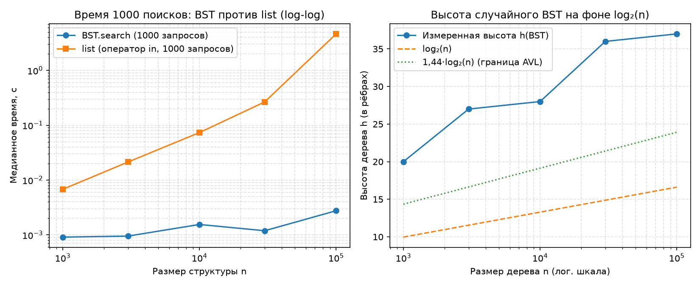

# Отчёт по ЛР 5. Бинарное дерево поиска: обходы, вставка и удаление

**Вариант 17** (seed генератора данных = 30 + 17 = **47**)
КИМ-05 — `M3-trees/kim-05-bst.md`

Код: [`../lab05_bst.py`](../lab05_bst.py) · Протокол запуска: [`lab05_run.log`](lab05_run.log)

Работа выполнена на стартовой заготовке КИМ-05: каркас проверок и бенчмарка
оставлен без изменений, заполнены только TODO — методы класса `BST` (`insert`,
`search`, `delete`, четыре обхода, `height`, `size`), собственные проверки
инвариантов и сохранение графиков.

---

## 1. Условия эксперимента

| Параметр | Значение |
| --- | --- |
| Процессор | Intel64 Family 6 Model 158 Stepping 9, GenuineIntel |
| ОС | Windows 11, 10.0.22000 |
| Python | CPython 3.12.0 (64 бит) |
| Таймер | `time.perf_counter()` |
| Прогрев | есть, первый запуск не учитывается |
| Повторов на точку | 5, берётся **медиана** |
| Запросов на замер | 1 000 случайных ключей из `[0, 10n]` |
| Данные | вариант 17, seed = 47 |

```bash
python lab05_bst.py --variant 17 --out report
```

---

## 2. Реализация `BST`

- **`insert(key)`** — итеративный спуск от корня до свободной позиции с сохранением
  инварианта (`левое поддерево < key < правое поддерево`). Повторная вставка
  существующего ключа игнорируется.
- **`search(key)`** — итеративный спуск от корня со сравнением ключей; возвращает
  строго `True` или `False`.
- **`delete(key)`** — обрабатывает все три случая:
  1. *лист* — ссылка у родителя (или `self.root`) обнуляется;
  2. *один ребёнок* — узел заменяется своим единственным ребёнком;
  3. *два ребёнка* — находится **преемник** (минимальный узел в правом поддереве,
     у которого гарантированно нет левого ребёнка), его ключ копируется в
     удаляемый узел, после чего сам преемник удаляется как узел с 0 или 1 ребёнком.
     Инвариант BST сохраняется, поскольку преемник строго больше всех ключей
     левого поддерева и строго меньше всех остальных ключей правого поддерева.
- **Обходы:**
  - `in_order` (лево → узел → право) — рекурсивно; для корректного BST выдаёт
    строго возрастающую последовательность ключей;
  - `pre_order` (узел → лево → право) — рекурсивно; фиксирует структуру дерева
    (используется для сериализации/копирования);
  - `post_order` (лево → право → узел) — рекурсивно; подходит для освобождения
    поддеревьев снизу вверх;
  - `level_order` — итеративно через очередь `collections.deque` (обход в ширину
    по уровням).
- **`height()` и `size()`** — реализованы итеративно с явным стеком; высота
  пустого дерева равна `−1`, дерева из одного узла — `0`.

---

## 3. Экспериментальное сравнение поиска: `BST` против `list`

Медианное время 1 000 поисков и высота дерева `h(BST)` на случайных ключах
(вариант 17, seed = 47):

| n | log₂(n) | h(BST) | h / log₂(n) | t(`BST`), с | t(`list`), с | Ускорение (`list`/`BST`) |
| ---: | ---: | ---: | ---: | ---: | ---: | ---: |
| 1 000 | 9,97 | 20 | 2,01 | 0,000911 | 0,006794 | **7,5×** |
| 3 000 | 11,55 | 27 | 2,34 | 0,000951 | 0,021330 | **22,4×** |
| 10 000 | 13,29 | 28 | 2,11 | 0,001549 | 0,073479 | **47,4×** |
| 30 000 | 14,87 | 36 | 2,42 | 0,001191 | 0,265995 | **223×** |
| 100 000 | 16,61 | 37 | 2,23 | 0,002757 | 4,631740 | **1 680×** |



### Анализ замеров

- При увеличении `n` в 100 раз (с 1 000 до 100 000):
  - время поиска в `list` выросло в **682 раза** (с 6,8 мс до 4,63 с; резкий скачок
    на `n = 100 000` дополнительно усиливается промахами кэша L2/L3 при линейном
    проходе по массиву ссылок), что соответствует **Θ(n)**;
  - высота случайного `BST` выросла всего в **1,85 раза** (с 20 до 37 рёбер), а
    время 1 000 поисков — в **3,0 раза** (с 0,91 мс до 2,76 мс), что соответствует
    логарифмическому росту **O(log n)**.
- Отношение `h(BST) / log₂(n)` держится в диапазоне **2,01–2,42**, что согласуется
  с теоретической оценкой ожидаемой высоты случайного BST (~2,99·log₂(n) асимптотически
  по теореме Девроя, ≈ 4,311·ln(n) при больших `n`, и порядка 2–2,5·log₂(n) на
  средних размерах).

---

## 4. Асимптотический анализ и деградация BST

Сложность каждой из базовых операций `insert`, `search` и `delete` определяется
длиной пути от корня до целевого узла (или листа) и составляет **O(h)**, где `h` —
высота дерева:

- **Случайный порядок вставки:** дерево остаётся статистически сбалансированным,
  `h = Θ(log n)`, поэтому среднее время `insert`/`search`/`delete` составляет
  **Θ(log n)**.
- **Упорядоченный (или обратно упорядоченный) порядок вставки:** каждый новый ключ
  оказывается строго больше (или меньше) всех предыдущих и подвешивается в крайнее
  правое (или левое) поддерево. Дерево вырождается в односвязный список высоты
  **h = n − 1**, и все три операции деградируют до **Θ(n)**.
- **Гарантия AVL-дерева:** самобалансирующееся AVL-дерево поддерживает для каждого
  узла разницу высот поддеревьев `|h(L) − h(R)| ≤ 1` с помощью малых и больших
  поворотов, что гарантирует высоту не более **1,44·log₂(n)** и сложность
  `insert`/`search`/`delete` **O(log n)** даже в худшем случае (экспериментальное
  исследование деградации выполнено в ДЗ 2 — папка `Case2/`).

---

## 5. Верификация (методика `docs/ai-verification.md`)

Все проверки оформлены через `expect(...)` (`SelfCheckError`), поэтому не отключаются
при запуске `python -O`. Прогон под `python -O` выполнен успешно — все 7 разделов `OK`.

1. **Шаг 1 (Инварианты):**
   - проверка `in_order()` на строгую упорядоченность после каждой операции;
   - собственная проверка `check_custom_invariants()` — рекурсивная проверка
     строгих границ `(low < node.key < high)` на каждом узле после каждой из 300
     случайных операций `insert`/`delete` (seed = 47), а также полное удаление всех
     узлов и повторное наполнение.
2. **Шаг 2 (Репрезентативные тесты):**
   - пустое дерево (`height = -1`, `size = 0`, пустые обходы, безопасное `delete`);
   - один узел (`height = 0`, `size = 1`), повторные вставки дубликатов;
   - эталонные деревья (идеальное дерево из 7 узлов и пример лекции 5 из 9 узлов)
     по всем четырём обходам;
   - вырожденная цепочка `1..50` (`height = 49`, `size = 50`);
   - все три случая удаления, включая 5 тестов удаления узла с двумя детьми с
     проверкой точной формы дерева через `pre_order()`.
3. **Шаг 3 (Сверка с эталоном):**
   - 100 случайных серий до 80 команд `insert`/`delete` сверены с `set` + `sorted()`
     после каждого шага; проверены `search`, `size`, все обходы и допустимые границы
     высоты `[⌊log₂ n⌋, n − 1]`. Расхождений нет.
4. **Шаг 4 (Оценка сложности):**
   - замеры подтвердили линейный рост `list` (`Θ(n)`) и логарифмический рост
     случайного `BST` (`O(log n)`).

**Вывод о применимости: принять.**

---

## 6. Выводы

1. Реализован класс `BST` со вставкой, поиском, удалением (все три случая, включая
   замену преемником), тремя рекурсивными обходами (`in_order`, `pre_order`,
   `post_order`) и итеративным `level_order` на `collections.deque`.
2. Все проверки инвариантов, репрезентативных тестов и сверки с эталоном
   `set`/`sorted` пройдены без расхождений (включая запуск `python -O`).
3. На случайных данных варианта 17 высота `BST` растёт логарифмически (от 20 при
   `n = 1 000` до 37 при `n = 100 000`), а поиск при `n = 100 000` оказывается в
   **1 680 раз** быстрее линейного поиска в списке.
4. Поскольку сложность операций равна `O(h)`, на упорядоченных данных обычное BST
   вырождается в цепочку (`h = n − 1`, операции `O(n)`); для гарантированного
   `O(log n)` в худшем случае требуется балансировка (например, AVL-дерево с
   высотой ≤ `1,44·log₂(n)`).
