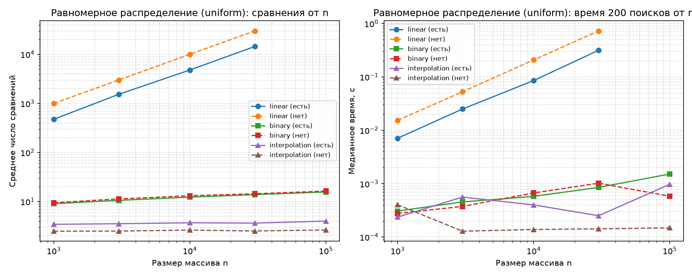
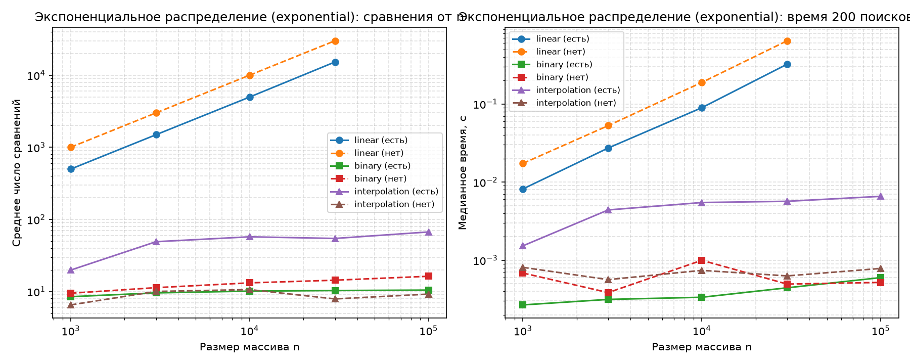

# Отчёт по ЛР 6. Линейный, бинарный и интерполяционный поиск

**Вариант 17** (seed генератора данных = 30 + 17 = **47**)
КИМ-06 — `M4-search-and-hashing/kim-06-search-linear-structures.md`

Код: [`../lab06_search.py`](../lab06_search.py) · Протокол запуска: [`lab06_run.log`](lab06_run.log)

Работа выполнена на стартовой заготовке КИМ-06: каркас генерации данных,
самопроверки и замеров оставлен без изменений, заполнены только TODO — три
функции поиска (`linear_search`, `binary_search`, `interpolation_search`) и
построение графиков.

---

## 1. Условия эксперимента

| Параметр | Значение |
| --- | --- |
| Процессор | Intel64 Family 6 Model 158 Stepping 9, GenuineIntel |
| ОС | Windows 11, 10.0.22000 |
| Python | CPython 3.12.0 (64 бит) |
| Таймер | `time.perf_counter()` |
| Прогрев | есть, первый прогон серии не учитывается |
| Повторов на точку | 5, берётся **медиана** |
| Ключей в серии | 200 (отдельно присутствующие и отсутствующие) |
| Размеры массивов `n` | 1 000, 3 000, 10 000, 30 000, 100 000 (`linear` до 30 000) |
| Данные | вариант 17, seed = 47; распределения `uniform` и `exponential` |

```bash
python lab06_search.py --variant 17 --out report
```

---

## 2. Реализация и инварианты

- **`linear_search(a, key)`** — последовательный проход слева направо; возвращает
  индекс первого вхождения (или `−1`) и число сравнений. Сложность: **O(n)**
  (в среднем `n/2` сравнений для присутствующих ключей, ровно `n` — для
  отсутствующих).
- **`binary_search(a, key)`** — поддерживает инвариант отрезка `[lo, hi]`: если
  `key` есть в `a`, то `a[lo] <= key <= a[hi]`. На каждом шаге вычисляется
  `mid = lo + (hi - lo) // 2`, длина отрезка строго уменьшается минимум вдвое
  (`lo = mid + 1` или `hi = mid - 1`), что гарантирует завершение за
  **O(log n)** сравнений независимо от распределения значений.
- **`interpolation_search(a, key)`** — вычисляет зонд по формуле линейной
  интерполяции `mid = lo + (key - a[lo]) * (hi - lo) // (a[hi] - a[lo])`.
  Реализованы две обязательные защиты:
  1. проверка выхода за границы диапазона `key < a[lo] or key > a[hi]` — немедленный
     возврат `−1` (исключает выход `mid` за `[lo, hi]`);
  2. проверка `a[hi] == a[lo]` — защита от деления на ноль на участках из
     одинаковых элементов.

---

## 3. Результаты замеров

### 3.1 Равномерное распределение (`uniform`)

| n | Ключ | `linear` сравн. / t (с) | `binary` сравн. / t (с) | `interpolation` сравн. / t (с) |
| ---: | --- | ---: | ---: | ---: |
| 1 000 | есть | 474,9 / 0,007089 | 9,1 / 0,000307 | **3,4** / 0,000237 |
| 1 000 | нет | 1 000,0 / 0,015367 | 9,5 / 0,000277 | **2,5** / 0,000403 |
| 3 000 | есть | 1 530,1 / 0,025025 | 10,6 / 0,000455 | **3,5** / 0,000562 |
| 3 000 | нет | 3 000,0 / 0,052689 | 11,3 / 0,000375 | **2,5** / 0,000129 |
| 10 000 | есть | 4 791,1 / 0,085485 | 12,3 / 0,000578 | **3,7** / 0,000400 |
| 10 000 | нет | 10 000,0 / 0,208107 | 13,1 / 0,000670 | **2,6** / 0,000139 |
| 30 000 | есть | 14 433,0 / 0,315133 | 13,8 / 0,000852 | **3,6** / 0,000251 |
| 30 000 | нет | 30 000,0 / 0,726760 | 14,4 / 0,001021 | **2,5** / 0,000143 |
| 100 000 | есть | — | 15,7 / 0,001517 | **4,0** / 0,000975 |
| 100 000 | нет | — | 16,4 / 0,000583 | **2,6** / 0,000149 |



### 3.2 Экспоненциальное распределение (`exponential`)

| n | Ключ | `linear` сравн. / t (с) | `binary` сравн. / t (с) | `interpolation` сравн. / t (с) |
| ---: | --- | ---: | ---: | ---: |
| 1 000 | есть | 498,3 / 0,008153 | **8,5** / 0,000267 | 19,8 / 0,001523 |
| 1 000 | нет | 1 000,0 / 0,017318 | 9,5 / 0,000684 | 6,5 / 0,000809 |
| 3 000 | есть | 1 494,0 / 0,027285 | **9,6** / 0,000314 | 49,0 / 0,004395 |
| 3 000 | нет | 3 000,0 / 0,052809 | 11,3 / 0,000384 | 10,0 / 0,000563 |
| 10 000 | есть | 4 971,6 / 0,089490 | **10,1** / 0,000335 | 57,3 / 0,005466 |
| 10 000 | нет | 10 000,0 / 0,188636 | 13,2 / 0,000995 | 10,6 / 0,000740 |
| 30 000 | есть | 15 242,9 / 0,323042 | **10,3** / 0,000442 | 54,4 / 0,005669 |
| 30 000 | нет | 30 000,0 / 0,644458 | 14,3 / 0,000493 | 7,9 / 0,000628 |
| 100 000 | есть | — | **10,5** / 0,000597 | 66,9 / 0,006562 |
| 100 000 | нет | — | 16,3 / 0,000519 | 9,2 / 0,000783 |



---

## 4. Сопоставление с теорией: `O(log n)` против `O(log log n)`

- **Линейный поиск — `Θ(n)`.** Число сравнений для отсутствующего ключа равно
  ровно `n`, для присутствующего — около `n/2` (при `n = 30 000`: 14 433 и 15 243).
  Затраты растут строго линейно и на `n = 30 000` в ~370–700 раз уступают бинарному.
- **Бинарный поиск — `O(log n)` независимо от распределения.** На обоих
  распределениях число сравнений для отсутствующих ключей растёт от 9,5 до 16,4,
  что в точности повторяет `log₂(n)` (`log₂(1 000) ≈ 10`, `log₂(100 000) ≈ 16,6`).
  На `exponential` для присутствующих ключей сравнений даже меньше (10,5 при
  `n = 100 000`) из-за большого числа повторяющихся малых значений.
- **Интерполяционный поиск на `uniform` — `O(log log n)`.** Поскольку значения
  растут почти линейно с индексом, формула зонда попадает в окрестность искомого
  ключа за 1–2 шага. При росте `n` в 100 раз (от `10³` до `10⁵`) среднее число
  сравнений для присутствующего ключа выросло лишь с **3,4 до 4,0**
  (`log₂(log₂(10⁵)) ≈ 4,05`), что в **4 раза меньше**, чем у бинарного поиска.
  Для отсутствующих ключей среднее число сравнений ещё меньше (2,5–2,6), так как
  часть ключей отсекается сразу по проверке границ `[a[lo], a[hi]]`.
- **Деградация интерполяционного поиска на `exponential` (в пределе к `O(n)`).**
  У экспоненциального распределения основная масса элементов сгущается около нуля,
  а редкий длинный «хвост» тянет `a[hi]` далеко вверх. Из-за этого линейная оценка
  `mid` систематически занижает позицию ключа и сужает отрезок очень малыми шагами.
  Результат на присутствующих ключах при `n = 100 000`: **66,9 сравнений** против
  **10,5** у бинарного (и время **6,56 мс против 0,60 мс** — в **11 раз медленнее**,
  поскольку к большему числу итераций добавляется более дорогая арифметика деления).

---

## 5. Верификация (методика `docs/ai-verification.md`)

1. **Инварианты:** проверено сохранение границ `[lo, hi]` и обязательное
   уменьшение отрезка на каждой итерации, а также защита от `a[hi] == a[lo]`.
2. **Репрезентативные тесты:** пустой массив (`(-1, 0)`), один элемент (найден /
   не найден), массив из всех равных элементов `[5, 5, 5, 5]` (защита от деления на
   ноль), первый и последний элементы, отсутствующие ключи внутри и вне диапазона.
3. **Сверка с эталоном:** 300 случайных отсортированных массивов с дубликатами
   сверены с `bisect.bisect_left`, оператором `in` и `list.index` (для
   `linear_search`). Проверено ведение счётчика сравнений (`cmp_count >= 1`).
4. **Оценка сложности:** подтверждена замерами на двух распределениях.

**Вывод о применимости: принять.**

---

## 6. Выводы

1. Линейный поиск имеет сложность `Θ(n)` и оправдан только на несортированных или
   очень малых массивах.
2. Бинарный поиск устойчив к любому распределению ключей и гарантирует `O(log n)`
   сравнений и времени в худшем случае (9–16 сравнений на `n` до 100 000).
3. Интерполяционный поиск уверенно превосходит бинарный на равномерных данных
   (`O(log log n)`: 3,4–4,0 сравнения против 9,1–15,7), но на сильно неравномерных
   данных (экспоненциальное распределение) деградирует (до 66,9 сравнений и в 11 раз
   медленнее бинарного при `n = 100 000`).
4. В качестве универсального алгоритма поиска по отсортированному массиву следует
   выбирать бинарный поиск; интерполяционный стоит применять только при известной
   равномерности ключей (либо с переключением на бинарный при медленном сужении
   отрезка).
