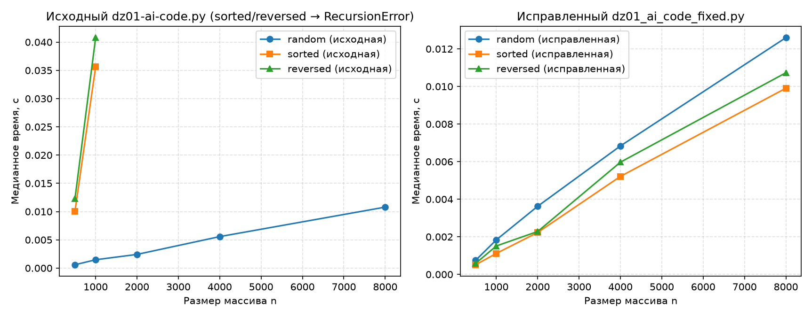

# Отчёт по ДЗ 1 (Кейс 1). Верификация ИИ-сгенерированной сортировки

**Вариант 17** (seed генератора данных = 30 + 17 = **47**)
КИМ-01 — `Cases/kim-01-ai-verification-sort.md`

Код верификации: [`../dz01_verification.py`](../dz01_verification.py) ·
Исходный файл (без изменений): [`../dz01-ai-code.py`](../dz01-ai-code.py) ·
Исправленная версия: [`../dz01_ai_code_fixed.py`](../dz01_ai_code_fixed.py) ·
Протокол запуска: [`dz01_run.log`](dz01_run.log)

---

## 1. Заявленные свойства проверяемого кода (`dz01-ai-code.py`)

В docstring `quicksort(data)` заявлены следующие свойства, подлежащие проверке:
1. Корректная сортировка списка целых чисел без изменения входного списка.
2. Временная сложность: **`O(n log n)`**.
3. Пространственная сложность: **`O(log n)`** (только стек рекурсии).

---

## 2. Результаты верификации исходного кода (шаги 1–4)

### Шаг 1. Инварианты сортировки

Реализованы и проверены на эталоне `sorted()` (100 случайных прогонов) два инварианта:
- **Инвариант 1 (`is_sorted`):** `a[i] <= a[i + 1]` для всех `i`.
- **Инвариант 2 (`same_multiset`):** `len(a) == len(b)` и `Counter(a) == Counter(b)`.

Проверка одной лишь упорядоченности недостаточна: функция, теряющая дубликаты
(или возвращающая пустой список), проходит `is_sorted`, но нарушает `same_multiset`.

### Шаг 2. Репрезентативные тесты

| Класс входов | Результат | Детали |
| --- | --- | --- |
| пустой `[]`, один элемент `[42]`, два разных `[1, 2]`, `[2, 1]` | OK | — |
| два равных `[5, 5]` | **FAIL** | `[5, 5] -> [5]` (нарушен инвариант 2) |
| все элементы равны `[7] * 10` | **FAIL** | `[7]*10 -> [7]` (нарушен инвариант 2) |
| уже отсортированный / обратно отсортированный (`n = 20`) | OK | на малом `n` без дубликатов дефект скрыт |
| случайный с дубликатами и отрицательными (`n = 30`) | **FAIL** | длина сократилась `30 -> 16` |
| случайный без дубликатов (`n = 25`) | OK | — |

### Шаг 3. Сверка с эталоном `sorted()` (300 случайных прогонов, seed = 47)

- Всего прогонов: **300**, расхождений: **243** (81 %).
- **Минимальный контрпример:** вход `[-8, -8]` → выход `[-8]`, эталон `[-8, -8]`.

### Шаг 4. Бенчмарк на трёх классах входов (прогрев, 5 повторов, медиана)

| n | `random`, с | `sorted`, с | `reversed`, с |
| ---: | ---: | ---: | ---: |
| 500 | 0,000590 | 0,010016 | 0,012265 |
| 1 000 | 0,001476 | 0,035612 | 0,040788 |
| 2 000 | 0,002419 | **RecursionError** | **RecursionError** |
| 4 000 | 0,005573 | **RecursionError** | **RecursionError** |
| 8 000 | 0,010793 | **RecursionError** | **RecursionError** |

На `sorted` и `reversed` при удвоении `n` (500 → 1 000) время растёт почти в **4 раза**
(`0,010 → 0,036 с` и `0,012 → 0,041 с`), что подтверждает квадратичную деградацию
**Θ(n²)**, а начиная с `n = 2 000` глубина рекурсии превышает лимит стека Python
(~1 000 кадров) и происходит аварийное завершение `RecursionError`.

---

## 3. Реестр найденных дефектов

| № | Дефект | Симптом | Класс входов | Причина в `dz01-ai-code.py` |
| --- | --- | --- | --- | --- |
| Д1 | Потеря дубликатов (критический дефект корректности) | Исчезают все повторения опорных элементов (`[-8, -8] -> [-8]`) | Любые входы с дубликатами | Строки 29–31: `smaller` (`< pivot`) и `larger` (`> pivot`) исключают элементы `== pivot`, а в результат добавляется только один `[pivot]` |
| Д2 | Деградация до `Θ(n²)` и `RecursionError` | Рост времени ×4 при удвоении `n`; `RecursionError` при `n ≥ 2 000` | `sorted` и `reversed` | Строка 28: `pivot = data[0]` всегда выбирает минимум/максимум, разбиение `0` и `n − 1`, глубина рекурсии `Θ(n)` |
| Д3 | Недостоверная оценка памяти в docstring | Заявлено `O(log n)`, фактически `Θ(n)` (до `Θ(n²)` в худшем случае) | Все входы | Строки 29–31: генераторы списков `smaller`, `larger` и конкатенация создают новые списки на каждом уровне рекурсии |

---

## 4. Вердикт о применимости

**Вердикт: ОТКЛОНИТЬ.**

Обоснование: реализация нарушает базовый инвариант сортировки (теряет дубликаты в
81 % случайных прогонов), не соответствует заявленной временной сложности
`O(n log n)` (деградирует до `Θ(n²)`) и аварийно падает с `RecursionError` на
упорядоченных и обратно упорядоченных массивах уже при `n = 2 000`.

---

## 5. Исправление и повторная верификация (`dz01_ai_code_fixed.py`)

В отдельной копии `dz01_ai_code_fixed.py` внесены исправления:
1. **Трёхпутевое разбиение** (`smaller`, `equal`, `larger`) — сохраняет все дубликаты
   и обрабатывает массивы из равных элементов за `O(n)`.
2. **Опорный элемент «медиана из трёх»** (`data[0]`, `data[n // 2]`, `data[-1]`) —
   устраняет вырожденные разбиения на `sorted` и `reversed`.
3. В docstring указана фактическая оценка дополнительной памяти `O(n)`.

### Результаты повторной верификации (seed = 47)

- **Шаг 2 (репрезентативные тесты):** все 10 классов — **OK**.
- **Шаг 3 (сверка с `sorted()`, 300 прогонов):** **0 расхождений**.
- **Шаг 4 (бенчмарк):**

| n | `random`, с | `sorted`, с | `reversed`, с |
| ---: | ---: | ---: | ---: |
| 500 | 0,000750 | 0,000513 | 0,000587 |
| 1 000 | 0,001837 | 0,001116 | 0,001512 |
| 2 000 | 0,003626 | 0,002231 | 0,002283 |
| 4 000 | 0,006836 | 0,005215 | 0,005971 |
| 8 000 | 0,012598 | 0,009906 | 0,010730 |

Аварийных завершений нет, время на всех трёх классах входов растёт как `O(n log n)`.
**Итоговый вердикт для исправленной версии: принять.**
