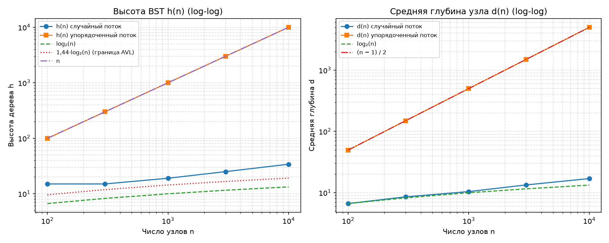
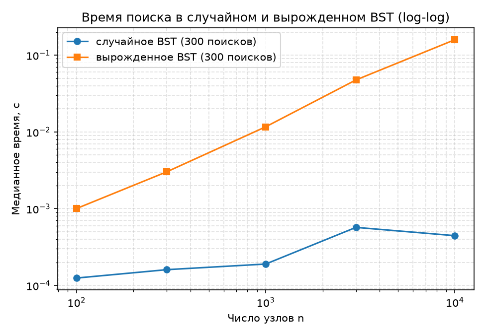

# Отчёт по ДЗ 2 (Кейс 2). Высота BST и деградация операций

**Вариант 17** (seed генератора данных = 30 + 17 = **47**)
КИМ-02 — `Cases/kim-02-bst-height-experiment.md`

Код: [`../dz02_bst_height.py`](../dz02_bst_height.py) · Протокол запуска: [`dz02_run.log`](dz02_run.log)

---

## 1. Условия эксперимента

| Параметр | Значение |
| --- | --- |
| Процессор | Intel64 Family 6 Model 158 Stepping 9, GenuineIntel |
| ОС | Windows 11, 10.0.22000 |
| Python | CPython 3.12.0 (64 бит) |
| Потоки вставок | случайный (`rng.sample`, seed = 47) и упорядоченный (`1..n`) |
| Размеры `n` | 100, 300, 1 000, 3 000, 10 000 |
| Замер поиска | 300 запросов (50 % присутствующих, 50 % отсутствующих), прогрев + медиана по 5 повторам |

Все операции (`insert_iter`, `tree_height`, `sum_depths`, `count_nodes`, `inorder_keys`)
реализованы **итеративно**, так как на упорядоченном потоке глубина дерева достигает
`n − 1 = 9 999`, что при рекурсии вызывает `RecursionError`.

---

## 2. Результаты эксперимента

| n | `h_случ` | `d_случ` | `h_упор` | `d_упор` | `log₂(n)` | `t_случ`, с | `t_упор`, с | Замедление (`упор`/`случ`) |
| ---: | ---: | ---: | ---: | ---: | ---: | ---: | ---: | ---: |
| 100 | 15 | 6,6 | 99 | 49,5 | 6,6 | 0,000125 | 0,001004 | **8,0×** |
| 300 | 15 | 8,5 | 299 | 149,5 | 8,2 | 0,000161 | 0,003023 | **18,8×** |
| 1 000 | 19 | 10,4 | 999 | 499,5 | 10,0 | 0,000190 | 0,011660 | **61,4×** |
| 3 000 | 25 | 13,4 | 2 999 | 1 499,5 | 11,6 | 0,000571 | 0,047575 | **83,3×** |
| 10 000 | 34 | 17,0 | 9 999 | 4 999,5 | 13,3 | 0,000445 | 0,158977 | **357×** |

---

## 3. Объяснение деградации операций

- **Случайный поток вставок:** ключи распределяются примерно поровну между левым и
  правым поддеревьями. Ожидаемая средняя глубина узла составляет
  `d ≈ 1,39·log₂(n)` (на замерах: от `1,00·log₂(n)` до `1,28·log₂(n)`), а высота —
  `h = Θ(log n)` (от 15 до 34 при росте `n` в 100 раз). Время 300 поисков выросло
  всего в **3,6 раза** (с 0,125 мс до 0,445 мс).
- **Упорядоченный поток (`1, 2, …, n`):** каждый новый ключ больше всех предыдущих
  и всегда добавляется в правую ветвь последнего узла. Дерево полностью вырождается
  в **односвязный список**:
  - высота точно равна `h = n − 1` (99, 299, 999, 2 999, 9 999);
  - средняя глубина точно равна `(0 + 1 + … + (n − 1)) / n = (n − 1) / 2`
    (49,5; 149,5; 499,5; 1 499,5; 4 999,5).
- Поскольку сложность `insert`, `search` и `delete` определяется длиной пути от корня
  `O(h)`, на упорядоченном потоке все операции деградируют до **Θ(n)**. При
  `n = 10 000` поиск в вырожденном дереве в **357 раз** медленнее, чем в случайном
  (159 мс против 0,445 мс).

---

## 4. Теоретическая справка: AVL-дерево и цена балансировки

- **Гарантия AVL-дерева:** для каждого узла поддерживается инвариант баланс-фактора
  `|h(left) − h(right)| ≤ 1`. Минимальное число узлов в AVL-дереве высоты `h`
  растёт как числа Фибоначчи (`N(h) = F(h + 3) − 1`), откуда следует строгая
  верхняя граница высоты: **h < 1,44·log₂(n + 2) − 0,328 ≈ 1,44·log₂(n)**.
  Для `n = 10 000` это не более **19 рёбер** (против 9 999 у вырожденного BST и 34
  у случайного BST).
- **Механизм поддержания баланса:** при `insert` и `delete` пересчитываются высоты
  на пути к корню; при нарушении `|bf| = 2` выполняется малый (LL/RR) или большой
  (LR/RL) поворот за `O(1)` времени.
- **Цена балансировки:**
  - дополнительная память в каждом узле для хранения высоты или баланс-фактора;
  - усложнение кода вставки и особенно удаления (при удалении повороты могут
    потребоваться на нескольких уровнях вверх до корня);
  - увеличенная константа времени на операциях модификации по сравнению с простым BST.

---

## 5. Верификация измерительных функций

Пройдены все проверки `self_check`:
- пустое дерево (`h = -1`, `avg_depth = 0.0`) и один узел (`h = 0`, `size = 1`);
- сбалансированное дерево `[2, 1, 3]` (`h = 1`, `sum_depths = 2`);
- вырожденная цепочка `1..100` (`h = 99 == n − 1`, `avg_depth = 49.5 == (n − 1) / 2`);
- 200 случайных деревьев сверены с эталоном `sorted()` через итеративный `inorder_keys`.

**Вывод о применимости: принять.**

---

## 6. Выводы и рекомендация

1. Высота обычного BST критически зависит от порядка поступления ключей: от
   `h = 34` (`O(log n)`) на случайном потоке до `h = 9 999` (`n − 1`) на
   упорядоченном при `n = 10 000`, что замедляет поиск в **357 раз**.
2. **Когда достаточно обычного BST:** поток ключей гарантированно случайный или
   предварительно перемешан (`random.shuffle`), дерево строится однократно для
   короткоживущих вычислений и не критично к редкому худшему случаю.
3. **Когда необходимо сбалансированное дерево (AVL / Red-Black):** ключи поступают
   в упорядоченном, почти упорядоченном или управляемом пользователем порядке
   (временные метки, автоинкрементные ID, внешние запросы), либо требуется
   гарантированная сложность `O(log n)` в худшем случае (SLA, реальное время).
